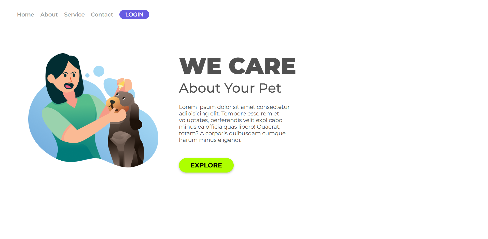
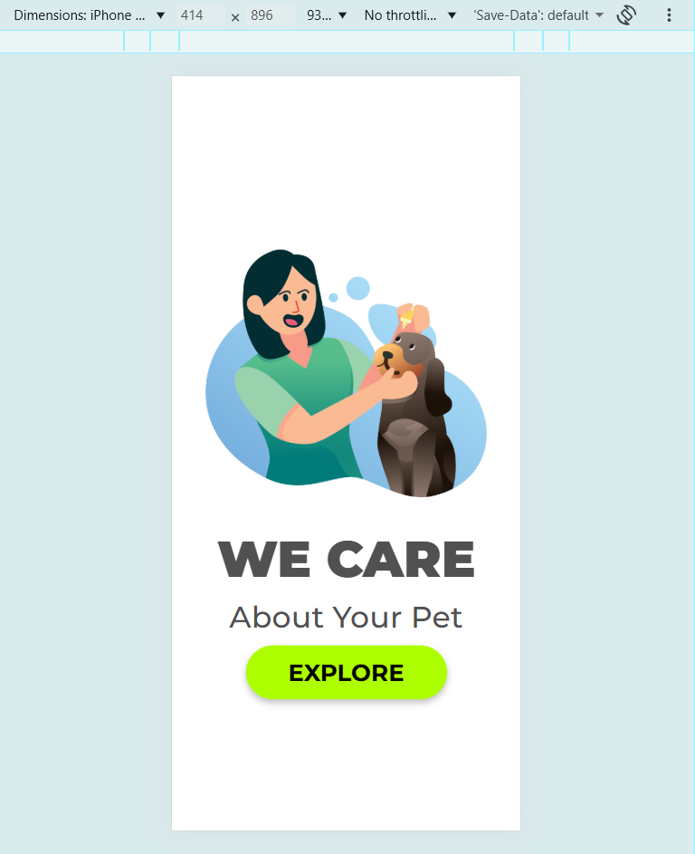

# 💻 Landing Page Inicial - Desktop & Mobile (Projeto 1)

Primeiro projeto prático focado na construção da página inicial (*landing page*) de um website moderno, aplicando os conceitos fundamentais de estruturação com **HTML5**, estilização com **CSS3** e adaptação para **dispositivos móveis**.

---

### 🌐 Demonstração Online

Veja o projeto funcionando em tempo real no navegador:

👉 **[Clique aqui para acessar o projeto online](https://lmvc007.github.io/projeto-1/)**

---

### 📸 Preview do Projeto

Confira a adaptação visual do layout entre desktop e celular:

#### 🖥️ Versão Desktop
<p align="center">
  
</p>

#### 📱 Versão Mobile
<p align="center">
  
</p>

---

### ✨ O que foi praticado neste projeto

- 🧱 **Semântica HTML:** Organização lógica de cabeçalho, seções e rodapé.

- 🎨 **Estilização com CSS3:** Aplicação de paleta de cores, tipografia e espaçamentos consistentes.

- 📐 **Responsividade:** Uso de *Media Queries* para garantir que o layout não quebre em telas menores.

---

### 🛠️ Tecnologias Utilizadas

- **HTML5:** Marcação e estrutura da página.

- **CSS3:** Estilização e regras de responsividade.

---

### 🚀 Como rodar o projeto localmente

Para clonar e testar o código na sua máquina:

1. Clone o repositório:
```bash
git clone https://github.com/LMVC007/projeto-1.git
